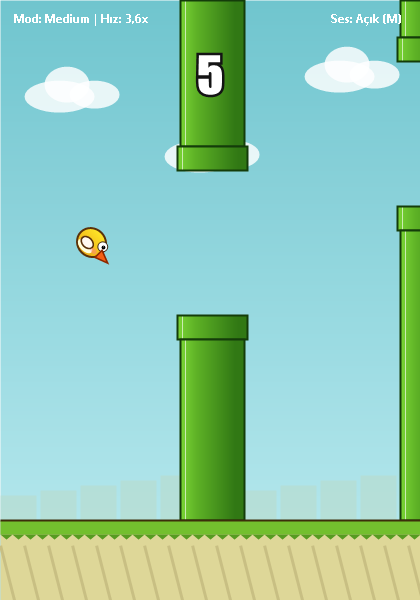

# YMH219 - Flappy Bird Masaüstü Oyunu


Bu proje, **Nesne Tabanlı Programlama (YMH 219)** dersi laboratuvar / ek uygulama ödevleri kapsamında geliştirilmiş nesne yönelimli bir **Flappy Bird** masaüstü oyunudur.

C# ve Windows Forms teknolojisi kullanılarak geliştirilen projede; form ve klavye olayları, zamanlayıcı (Timer) tabanlı oyun döngüsü, çift tamponlama (Double Buffering) ile 60 FPS akıcı GDI+ çizimi, nesne tabanlı mimari ve dosya tabanlı yüksek skor kalıcılığı uygulanmıştır.

---

## 📸 Ekran Görüntüleri

| Başlangıç / Hazır Ekranı | Oyun İçi Oynanış | Oyun Bitti (Game Over) |
| :---: | :---: | :---: |
|  |  |  |

---

## 🛠️ Kullanılan Teknolojiler ve Kütüphaneler

- **Programlama Dili:** C# 12
- **Çalışma Zamanı (Runtime):** .NET 8.0 Windows Desktop (`net8.0-windows`)
- **Arayüz Kütüphanesi:** Windows Forms (WinForms)
- **Çizim Motoru:** GDI+ (`System.Drawing`, `System.Drawing.Drawing2D`)
  - Titremesiz (flicker-free) render için `DoubleBuffered = true` ve `SetStyle` optimizasyonları
- **Ses Sistemi:** Bellek içi prosedürel PCM WAV sentezleyici + `System.Media.SoundPlayer` (Harici .wav bağımlılığı gerektirmez)
- **Harici NuGet Paketleri:** Proje hiçbir harici paket bağımlılığı gerektirmeden saf .NET BCL ile çalışacak şekilde optimize edilmiştir.

---

## 🚀 Kurulum ve Çalıştırma Adımları

### Gereksinimler
- [.NET 8.0 SDK](https://dotnet.microsoft.com/download/dotnet/8.0) veya üzeri
- Windows 10 / 11 işletim sistemi
- Visual Studio 2022 (Desktop Development with .NET iş yükü kurulu) veya VS Code / Terminal

### 1. Depoyu Klonlama
```bash
git clone https://github.com/ismailozdemir27/YMH219-FlappyBird.git
cd YMH219-FlappyBird
```

### 2. Projeyi Derleme
Terminal veya PowerShell üzerinden:
```bash
dotnet build
```

### 3. Oyunu Başlatma
```bash
dotnet run
```
Veya `FlappyBird.csproj` dosyasını **Visual Studio 2022** ile açıp `F5` tuşuna basarak başlatabilirsiniz.

---

## 🎮 Kontroller ve Oynanış

| Tuş | Eylem | Açıklama |
| :--- | :--- | :--- |
| **SPACE** / **Yukarı Ok** / **Sol Tık** | **Zıpla (Flap)** | Kuşu yukarı doğru sıçratır; oyun hazır modundaysa oyunu başlatır. |
| **P** / **ESC** | **Duraklat / Devam** | Oyunu dondurur veya devam ettirir. |
| **R** | **Yeniden Başlat** | Oyunu anında sıfırlar ve başlangıç durumuna döner. |
| **M** | **Sesi Aç / Kapa** | Retro ses efektlerini sessize alır ya da açar. |
| **1 / 2 / 3** | **Zorluk Seçimi** | **1:** Kolay, **2:** Orta, **3:** Zor seviyesine geçirir. |

---

## ✨ Uygulamanın Temel Özellikleri

1. **Fizik ve Yer Çekimi Simülasyonu:**
   - Kuş yer çekimi etkisiyle ivmeli şekilde düşer, zıplama tuşuna basıldığında dikey hız sıfırlanıp yukarı yönlü kuvvet uygulanır.
   - Hız durumuna göre kuşun baş açısı (-25° ile +70° arasında) dinamik olarak eğilir.

2. **Dinamik Engel ve Geri Dönüşüm (Object Recycling):**
   - Ekranda sağdan sola doğru hareket eden boru çiftleri bulunur.
   - Ekranın solundan çıkan borular bellekten silinmek yerine sıranın sonuna rastgele yüksekliklerle yeniden konumlandırılır (Nesne havuzu prensibi).

3. **Hassas Çarpışma Denetimi (Collision Detection):**
   - Kuşun hitbox'ı ile boruların dikdörtgen sınırları ve zemin çizgisi anlık kontrol edilir.
   - Oyuncuya adil oynanış sunmak adına kuş sınırlarında 3 piksellik pay bırakılmıştır.

4. **Skor ve Seviye Sistemi:**
   - Kuş boru çiftlerinin arasından her geçtiğinde skor 1 artar ve jeton sesi çalar.
   - Her 5 puanda bir oyun seviyesi artar ve oyun hızı dinamik olarak yükselir (Progresif zorluk).

5. **Kalıcı En Yüksek Skor (High Score):**
   - En yüksek skor yerel dosya sisteminde (`highscore.txt`) saklanır; oyun kapatılıp açılsa dahi rekor korunur.

6. **Zorluk Seviyeleri (İsteğe Bağlı Geliştirme):**
   - **Kolay:** Geniş boru aralığı (175px), düşük hız (2.8x), yumuşak yer çekimi.
   - **Orta:** Dengeli boru aralığı (145px), standart hız (3.6x).
   - **Zor:** Dar boru aralığı (120px), yüksek hız (4.4x), sert yer çekimi.

7. **Prosedürel 8-Bit Retro Ses Efektleri (İsteğe Bağlı Geliştirme):**
   - Harici ses dosyası bozulması veya yol hatalarını önlemek amacıyla zıplama, puan alma, çarpma ve ölüm sesleri doğrudan kod içerisinde PCM dalga formlarıyla üretilir.

8. **Madalya Sistemi:**
   - 5+ Skor: Bronz Madalya
   - 10+ Skor: Gümüş Madalya
   - 20+ Skor: Altın Madalya
   - 30+ Skor: Platin Madalya

---

## 🏛️ Nesne Tabanlı Tasarım ve Sınıf Mimarisi

```
YMH219-FlappyBird/
├── Core/
│   ├── GameEngine.cs       # Oyun döngüsü, fizik, durum geçişleri ve render orkestrasyonu
│   └── GameSettings.cs     # Zorluk dereceleri ve fizik katsayıları
├── Enums/
│   ├── GameState.cs        # Ready, Playing, Paused, GameOver durumları
│   └── Difficulty.cs       # Easy, Medium, Hard seviyeleri
├── Models/
│   ├── Bird.cs             # Kuş nesnesi (koordinatlar, ivme, kanat animasyonu, çizim)
│   ├── Pipe.cs             # Boru engeli (üst-alt koordinatlar, hitbox, çizim)
│   └── Ground.cs           # Zemin nesnesi (kayan doku, çim-toprak çizimi)
├── Services/
│   ├── ScoreManager.cs     # Skor takibi, rekor kontrolü ve dosya kaydı (I/O)
│   └── SoundManager.cs     # PCM ses sentezleme ve asenkron ses çalma
├── Forms/
│   ├── MainForm.cs         # Form kontrolü, giriş yakalama (klavye/fare)
│   └── MainForm.Designer.cs# Form bileşen tasarımı
├── Program.cs              # Uygulama başlangıç noktası
├── screenshots/            # README ekran görüntüleri
└── FlappyBird.csproj       # Proje yapılandırması (.NET 8 Windows Forms)
```

---

## ⚠️ Bilinen Sınırlamalar / Geliştirme Notları

- Oyun penceresi klasik arcade hissiyatını korumak için 420x600 sabit çözünürlükte tasarlanmıştır (Boyutlandırma kilitlidir).
- Ses sentezleyici Windows Media altyapısını (`System.Media.SoundPlayer`) kullandığından Windows işletim sistemi üzerinde optimize edilmiştir.
- Gelecek versiyonlarda çoklu kuş derisi (skin) seçimi ve çevrimiçi skor tablosu (online leaderboard) entegre edilebilir.

---

## 👤 Öğrenci Bilgileri

- **Adı - Soyadı:** İsmail Özdemir
- **Öğrenci Numarası:** [Öğrenci Numaranızı Buraya Ekleyiniz]
- **Ders:** Nesne Tabanlı Programlama (YMH 219)
- **Dönem:** 2026-2027 Güz
