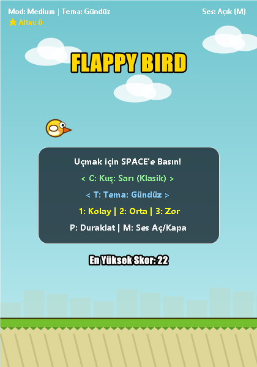
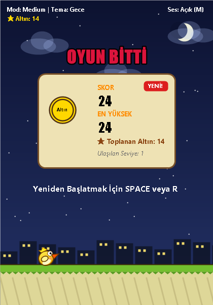

# YMH219 - Flappy Bird Masaüstü Oyunu


Bu proje, **Nesne Tabanlı Programlama (YMH 219)** dersi laboratuvar / ek uygulama ödevleri kapsamında geliştirilmiş nesne yönelimli bir **Flappy Bird** masaüstü oyunudur.

C# ve Windows Forms teknolojisi kullanılarak geliştirilen projede; form ve klavye olayları, zamanlayıcı (Timer) tabanlı oyun döngüsü, çift tamponlama (Double Buffering) ile 60 FPS akıcı GDI+ çizimi, nesne tabanlı mimari, **karakter kostüm sistemi**, **toplanabilir altınlar**, **gündüz/gün batımı/gece temaları** ve **yeni rekor fanfarı** uygulanmıştır.

---

## 📸 Ekran Görüntüleri

| Başlangıç / Hazır Ekranı | Oyun İçi (Gün Batımı & Altın Toplama) | Oyun Bitti (Gece Modu & Altın Anka) |
| :---: | :---: | :---: |
|  |  |  |

---

## 🛠️ Kullanılan Teknolojiler ve Kütüphaneler

- **Programlama Dili:** C# 12
- **Çalışma Zamanı (Runtime):** .NET 8.0 Windows Desktop (`net8.0-windows`)
- **Arayüz Kütüphanesi:** Windows Forms (WinForms)
- **Çizim Motoru:** GDI+ (`System.Drawing`, `System.Drawing.Drawing2D`)
  - Titremesiz (flicker-free) render için `DoubleBuffered = true` ve `SetStyle` optimizasyonları
- **Ses Sistemi:** Bellek içi prosedürel PCM WAV sentezleyici + `System.Media.SoundPlayer` (Harici .wav bağımlılığı gerektirmez)
- **Harici NuGet Paketleri:** Saf .NET BCL ile sıfır harici bağımlılık.

---

## 🚀 Kurulum ve Çalıştırma Adımları

### Gereksinimler
- [.NET 8.0 SDK](https://dotnet.microsoft.com/download/dotnet/8.0) veya üzeri
- Windows 10 / 11 işletim sistemi
- Visual Studio 2022 veya VS Code / Terminal

### 1. Depoyu Klonlama
```bash
git clone https://github.com/ismailozdemir27/YMH219-FlappyBird.git
cd YMH219-FlappyBird
```

### 2. Projeyi Derleme
```bash
dotnet build
```

### 3. Oyunu Başlatma
```bash
dotnet run
```
Veya `FlappyBird.csproj` dosyasını **Visual Studio 2022** ile açıp `F5` tuşuna basarak başlatabilirsiniz.

---

## 🎮 Kontroller ve Oynanış

| Tuş | Eylem | Açıklama |
| :--- | :--- | :--- |
| **SPACE** / **Yukarı Ok** / **Sol Tık** | **Zıpla (Flap)** | Kuşu yukarı doğru sıçratır; oyun hazır modundaysa oyunu başlatır. |
| **C** / **TAB** | **Kostüm Seçimi** | Kuş kostümünü anında değiştirir (Sarı, Mavi, Kırmızı, Pembe, Altın Anka). |
| **T** | **Tema Değiştir** | Gökyüzü temasını değiştirir (**Gündüz**, **Gün Batımı**, **Gece**). |
| **P** / **ESC** | **Duraklat / Devam** | Oyunu dondurur veya devam ettirir. |
| **R** | **Yeniden Başlat** | Oyunu anında sıfırlar ve başlangıç durumuna döner. |
| **M** | **Sesi Aç / Kapa** | Retro ses efektlerini sessize alır ya da açar. |
| **1 / 2 / 3** | **Zorluk Seçimi** | **1:** Kolay, **2:** Orta, **3:** Zor seviyesine geçirir. |

---

## ✨ Uygulamanın Temel ve Ekstra Özellikleri

1. **Yumuşatılmış Süzülme ve Akıcı Fizik:**
   - Kuşun yer çekimi düşüşü ve zıplama ivmesi çok daha yumuşak, keyifli ve dengeli bir uçuş hissi verecek şekilde optimize edildi.

2. **Genişletilmiş Boru Boşlukları (Ferah Oynanış):**
   - Boru açıklıkları (Gap) genişletildi; toplanabilir altınların arasından geçiş son derece akıcı ve tatmin edici hale getirildi.

3. **Toplanabilir Altınlar ve Yıldızlar (Collectibles):**
   - Boruların arasına kendi etrafında 3D dönen parlak altın paralar yerleştirildi.
   - Her altın toplandığında **özel kristal çan sesi** çalar, oyuncuya ekstra puan ve altın sayısı kazandırır.

4. **Yeni Rekor Zafer Fanfarı:**
   - Oyun esnasında tüm zamanların en yüksek skoru (High Score) kırıldığı anda **özel 4 tonlu yükselen zafer fanfarı** çalar!

5. **3 Farklı Görsel Arka Plan Teması:**
   - ☀️ **Gündüz:** Canlı açık mavi gökyüzü, beyaz bulutlar ve ferah şehir silüeti.
   - 🌅 **Gün Batımı:** Sıcak kızıl-turuncu gökyüzü, batan güneş ve mor binalar.
   - 🌙 **Gece:** Koyu lacivert gökyüzü, parıldayan 40 yıldız, hilal ay ve pencerelerinde ışıkları yanan gece şehri!

6. **Karakter ve Kostüm Seçimi:**
   - 🟡 **Sarı (Klasik):** Orijinal nostaljik sarı kuş.
   - 🔵 **Mavi (Fırtına):** Canlı elektrik mavisi kuş.
   - 🔴 **Kırmızı (Ateş):** Dikkat çekici yakut kırmızısı kuş.
   - 🌸 **Pembe (Şeker):** Tatlı pastel pembe kuş.
   - 👑 **Altın (Efsane Anka):** Başında parıldayan taç bulunan efsanevi altın kuş.

7. **Kalıcı En Yüksek Skor (High Score):**
   - Skor bilgisi yerel dosya sisteminde (`highscore.txt`) saklanır; oyun yeniden açıldığında rekor korunur.

8. **Madalya Sistemi:**
   - 5+ Skor: Bronz Madalya
   - 10+ Skor: Gümüş Madalya
   - 20+ Skor: Altın Madalya
   - 30+ Skor: Platin Madalya

---

## 🏛️ Nesne Tabanlı Tasarım ve Sınıf Mimarisi

```
YMH219-FlappyBird/
├── Core/
│   ├── GameEngine.cs          # Oyun döngüsü, fizik, tema geçişleri, render orkestrasyonu
│   └── GameSettings.cs        # Zorluk dereceleri, geniş boru aralıkları ve fizik katsayıları
├── Enums/
│   ├── GameState.cs           # Ready, Playing, Paused, GameOver durumları
│   ├── Difficulty.cs          # Easy, Medium, Hard seviyeleri
│   ├── BirdSkin.cs            # Karakter kostümleri (Sarı, Mavi, Kırmızı, Pembe, Altın)
│   └── GameTheme.cs           # Gündüz, Gün Batımı, Gece temaları
├── Models/
│   ├── Bird.cs                # Kuş fiziği, kanat animasyonu, kostüm, hitbox ve çizim
│   ├── Pipe.cs                # Boru engeli (üst-alt koordinatlar, hitbox, çizim)
│   ├── Coin.cs                # Boru arası toplanabilir 3D dönen altın para nesnesi
│   └── Ground.cs              # Hareketli zemin ve çim dokusu
├── Services/
│   ├── ScoreManager.cs        # Skor takibi, rekor kontrolü ve dosya I/O
│   └── SoundManager.cs        # PCM WAV ses sentezleyici (Zıplama, Altın, Rekor, Çarpma, Ölüm)
├── Forms/
│   ├── MainForm.cs            # Form kontrolü, giriş yakalama (klavye/fare)
│   └── MainForm.Designer.cs   # Form bileşen tasarımı
├── Program.cs              # Uygulama başlangıç noktası
├── screenshots/               # README ekran görüntüleri
│   ├── menu.png
│   ├── gameplay.png
│   └── gameover.png
├── .gitignore                 # Visual Studio / .NET için tam yalıtım
└── FlappyBird.csproj          # .NET 8.0 Windows Forms projesi
```

---

## 👤 Öğrenci Bilgileri

- **Adı - Soyadı:** İsmail Özdemir
- **Öğrenci Numarası:** [Öğrenci Numaranızı Buraya Ekleyiniz]
- **Ders:** Nesne Tabanlı Programlama (YMH 219)
- **Dönem:** 2026-2027 Güz
